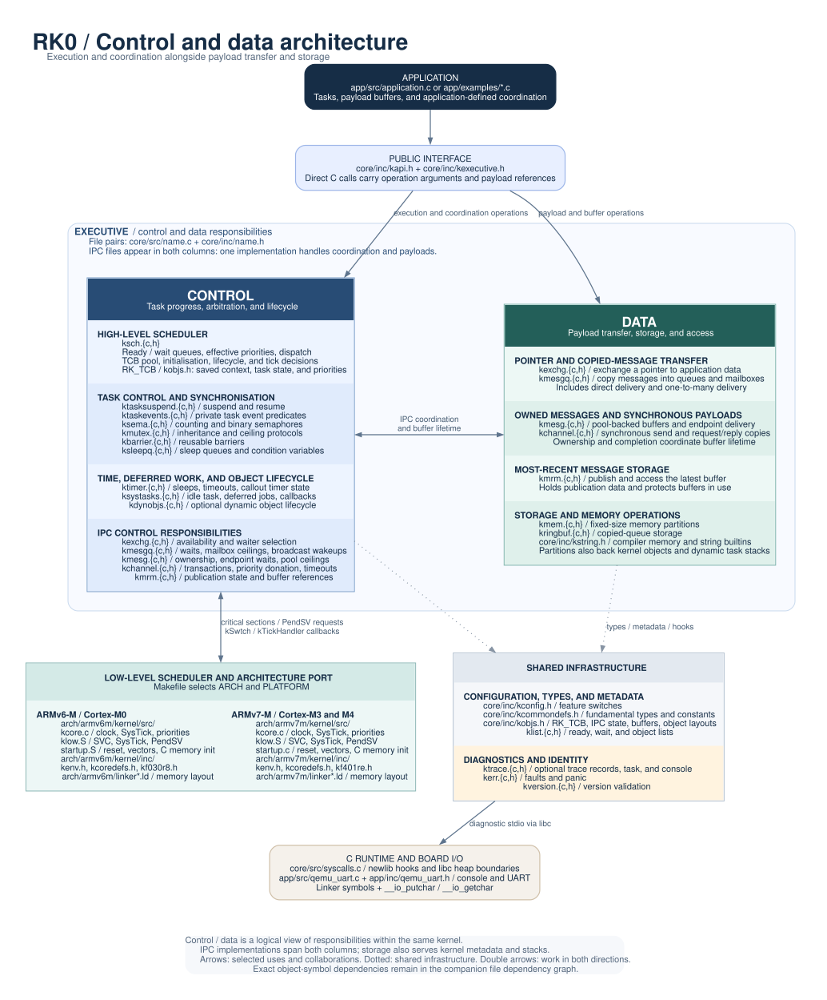
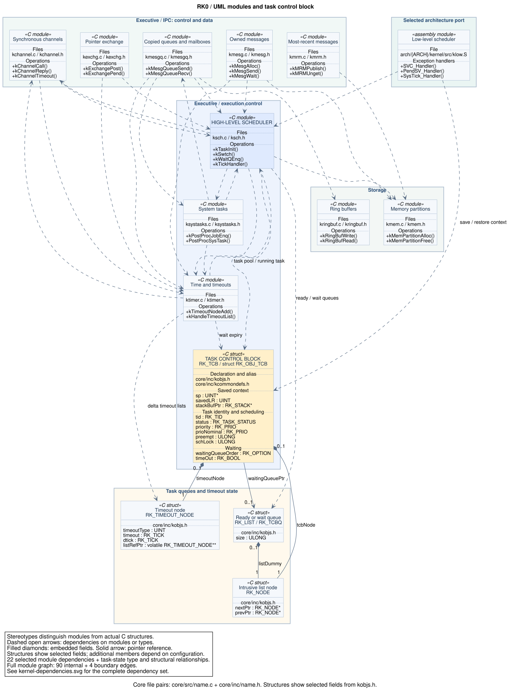
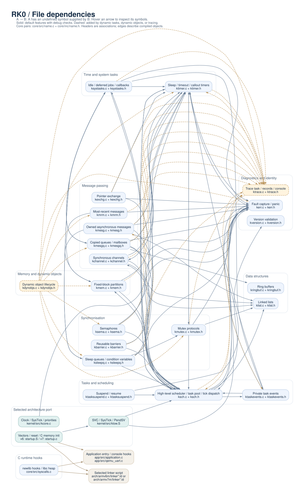
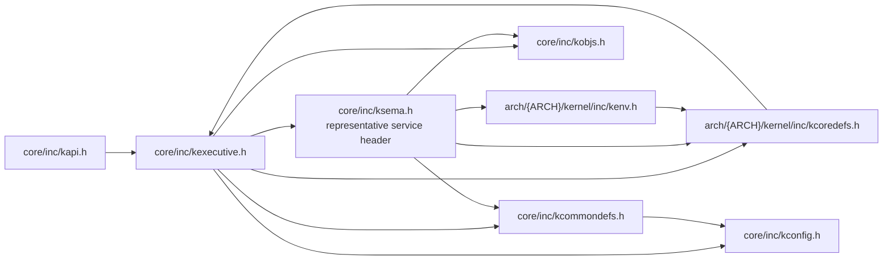

# RK0 kernel architecture

RK0 combines a C executive with an architecture-specific low-level scheduler.
The executive implements scheduling policy, task state, resource management,
and communication. The ARM port implements exception entry, context switching,
critical sections, and core hardware initialisation. Application tasks call the
kernel directly through its C API.

This map describes the working tree on 2026-10-26. It covers 22 core C files,
27 associated core headers, and both architecture ports. Application files
appear only where they supply entry points or console hooks.

## Architectural view



[Open the scalable diagram](diagrams/kernel-architecture.svg) ·
[PNG picture](diagrams/kernel-architecture.png) ·
[Edit its Graphviz source](diagrams/kernel-architecture.dot)

In the diagram, `name.{c,h}` associates `core/src/name.c` with
`core/inc/name.h`. The executive is divided into two views of responsibility:

- **Control** determines task progress: scheduling, blocking, wakeups,
  priority protocols, synchronisation, timeouts, and object lifecycle.
  `ksch` is the **high-level scheduler**; `klow.S` supplies the low-level
  context-switching mechanism in the selected architecture port.
- **Data** handles payload transfer and storage: pointer exchange, copied
  messages, owned buffers, synchronous request/reply payloads, most-recent
  publication buffers, memory partitions, and ring-buffer storage.

IPC modules appear in both columns because their implementations combine
these responsibilities. For example, `kmesgq.c` copies or queues a message
and readies an eligible waiting receiver. `kchannel.c` copies request/reply
payloads while managing transaction state, priority donation, and timeouts.
`kmrm.c` publishes data while tracking which buffers are still in use.

The split describes the existing implementation. Both sides share
configuration, object layouts, linked lists, and diagnostic hooks. Memory
partitions serve payload buffers, kernel objects, and dynamic task stacks.
Arrows show selected uses; double arrows indicate collaboration in both
directions. Dotted edges identify shared infrastructure. The companion file
dependency graph records the individual module relationships.

The executive has three closely connected implementation centres:

- **`ksch.c`**, the high-level scheduler, owns the ready queues, task pool, effective-priority handling,
  dispatch decisions, and tick handler. It requests PendSV through the port's
  register macros; `klow.S` calls back into `kSwtch()` and `kTickHandler()`.
- **`ktimer.c`** manages delta timeout lists, sleep primitives, and callout
  timers. Expiry readies tasks through the scheduler and invokes the mutex or
  channel cleanup required by the expired wait.
- **`ksystasks.c`** supplies the idle task and post-processing task. Task events
  wake post-processing to drain deferred work and run timer callbacks in task
  context.

## UML module dependency view



[Open the scalable UML diagram](diagrams/kernel-dependencies-uml.svg) ·
[PNG picture](diagrams/kernel-dependencies-uml.png) ·
[Edit its PlantUML source](diagrams/kernel-dependencies-uml.puml)

This view uses UML class notation with separate stereotypes for modules and
actual C structures. A module's file compartment identifies its implementation
and header; its operations compartment lists representative functions. The
assembly module lists its exception handlers. Dashed, open-headed dependency
arrows point from a client module to a supplier module or a type it uses.

The **task control block**, `RK_TCB`, is an alias for `struct RK_OBJ_TCB`.
[kobjs.h](../core/inc/kobjs.h) defines the structure and
[kcommondefs.h](../core/inc/kcommondefs.h) defines the alias and task-handle
pointer type. The diagram shows its saved context, task identity, scheduling
state, and selected wait fields. `ksch.c` manages the `RK_gTcbs` pool and
`RK_gRunPtr`; `klow.S` saves and restores task context through that pointer.
Timeout processing uses the TCB to expire waits and make tasks ready.

Filled diamonds show the embedded `timeoutNode` and `tcbNode` fields, plus
the `listDummy` sentinel embedded in each `RK_LIST` / `RK_TCBQ`. The solid
association labelled `waitingQueuePtr` is a nullable reference to a wait
queue. The structure boxes show selected fields; configuration adds further
task state for IPC and priority protocols.

The diagram retains 22 selected module dependencies covering IPC, execution
control, storage, and the low-level scheduler, and adds task-state type uses
and structural relationships. These type and field relationships come from
the source declarations. The complete file graph below retains all 90 internal
module dependencies and four application/linker boundary edges.

## Complete file dependency graph



[Open the full scalable dependency graph](diagrams/kernel-dependencies.svg) ·
[PNG picture](diagrams/kernel-dependencies.png) ·
[Edit its Graphviz source](diagrams/kernel-dependencies.dot)

Here, **A → B means A's object file has an undefined symbol provided by B's
object file**. This includes function references and shared data. The paired
header identifies the module's declarations; graph edges do not mean header
inclusion. Open the SVG directly and hover an arrow to see its symbol names
from the feature-enabled profile.

Solid edges occur with the default feature settings and debug checks. Dashed
amber edges are added when dynamic tasks, dynamic objects, and tracing are
enabled. Both ports have the same 64 default and 90 feature-enabled internal
dependency edges after normalising their port filenames. The graph adds four
boundary edges for application entry, console hooks, and linker symbols.

The port nodes represent whichever architecture is selected. Their source
links lead to ARMv7-M; the table below links both alternatives. Standard C
library and compiler support symbols are omitted from the graph.

### Module-to-file inventory

The providers below are exhaustive for the internal symbol edges in the
feature-enabled profile. **†** marks an edge added by that profile. A module
with no providers here can still depend on headers, compiler builtins, libc,
or architecture macros.

| Module and files | Responsibility | Core symbol providers |
| --- | --- | --- |
| [kexchg.c](../core/src/kexchg.c) + [kexchg.h](../core/inc/kexchg.h) | Pointer exchange | `kerr`, `ksch`, `ktimer`, `ktrace`† |
| [kmesgq.c](../core/src/kmesgq.c) + [kmesgq.h](../core/inc/kmesgq.h) | Copied queues / mailboxes | `kerr`, `klist`, `kringbuf`, `ksch`, `ksystasks`, `ktimer`, `ktrace`† |
| [kmesg.c](../core/src/kmesg.c) + [kmesg.h](../core/inc/kmesg.h) | Owned asynchronous messages | `kerr`, `klist`, `kmem`, `ksch`, `ktimer`, `ktrace`† |
| [kchannel.c](../core/src/kchannel.c) + [kchannel.h](../core/inc/kchannel.h) | Synchronous channels | `klist`, `ksch`, `ktimer`, `ktrace`† |
| [kmrm.c](../core/src/kmrm.c) + [kmrm.h](../core/inc/kmrm.h) | Most-recent messages | `kerr`, `kmem`, `ktrace`† |
| [ksema.c](../core/src/ksema.c) + [ksema.h](../core/inc/ksema.h) | Semaphores | `kerr`, `ksch`, `ktimer`, `ktrace`† |
| [kmutex.c](../core/src/kmutex.c) + [kmutex.h](../core/inc/kmutex.h) | Mutex protocols | `kerr`, `klist`, `ksch`, `ktimer`, `ktrace`† |
| [kbarrier.c](../core/src/kbarrier.c) + [kbarrier.h](../core/inc/kbarrier.h) | Reusable barriers | `kerr`, `ksch`, `ktrace`† |
| [ksleepq.c](../core/src/ksleepq.c) + [ksleepq.h](../core/inc/ksleepq.h) | Sleep queues / condition variables | `kerr`, `kmutex`, `ksch`, `ksystasks`, `ktimer`, `ktrace`† |
| [kmem.c](../core/src/kmem.c) + [kmem.h](../core/inc/kmem.h) | Fixed-block partitions | `kerr`, `ksch`, `ktrace`† |
| [kdynobjs.c](../core/src/kdynobjs.c) + [kdynobjs.h](../core/inc/kdynobjs.h) | Dynamic object lifecycle | `kerr`†, `kmem`†, `kmesgq`†, `kmrm`†, `kmutex`†, `ksema`†, `ksleepq`†, `ktimer`†, `ktrace`† |
| [ktasksuspend.c](../core/src/ktasksuspend.c) + [ktasksuspend.h](../core/inc/ktasksuspend.h) | Suspend / resume | `kerr`, `ksch` |
| [ktaskevents.c](../core/src/ktaskevents.c) + [ktaskevents.h](../core/inc/ktaskevents.h) | Private task events | `kerr`, `ksch`, `ktimer` |
| [ksch.c](../core/src/ksch.c) + [ksch.h](../core/inc/ksch.h) | High-level scheduler / task pool / tick dispatch | `kchannel`, `kerr`, `klist`, `kmem`, `kmesg`†, `ksystasks`, `ktaskevents`, `ktimer`, `ktrace`†, `kversion` |
| [ktimer.c](../core/src/ktimer.c) + [ktimer.h](../core/inc/ktimer.h) | Sleep / timeout / callout timers | `kchannel`, `kerr`, `kmutex`, `ksch`, `ktrace`† |
| [ksystasks.c](../core/src/ksystasks.c) + [ksystasks.h](../core/inc/ksystasks.h) | Idle / deferred jobs / callbacks | `kerr`, `kmesgq`, `ksch`, `ksleepq`, `ktaskevents`, `ktimer`, `ktrace`† |
| [klist.c](../core/src/klist.c) + [klist.h](../core/inc/klist.h) | Linked lists | None |
| [kringbuf.c](../core/src/kringbuf.c) + [kringbuf.h](../core/inc/kringbuf.h) | Ring buffers | None |
| [ktrace.c](../core/src/ktrace.c) + [ktrace.h](../core/inc/ktrace.h) | Trace task / records / console | `ksch`†, `ktaskevents`†, `ktimer`† |
| [kerr.c](../core/src/kerr.c) + [kerr.h](../core/inc/kerr.h) | Fault capture / panic | `ksch`, `ktimer` |
| [kversion.c](../core/src/kversion.c) + [kversion.h](../core/inc/kversion.h) | Version validation | None |
| [syscalls.c](../core/src/syscalls.c) | newlib hooks / libc heap | Linker symbols, libc, board I/O hooks |

Several relationships explain the cycles in the graph:

- `ksch → kchannel` queries channel-related priority contributions. In the
  feature-enabled profile, `ksch → kmesg` also tears down messaging endpoints
  during dynamic task termination.
- `ktimer → kmutex` calls `kMutexTimeoutWaiter()` to repair mutex priority
  state. This function is declared with `extern` in `ktimer.c`, illustrating
  why includes alone do not capture the dependencies.
- `ksleepq → kmutex` implements condition-variable release and reacquisition.
  `ksleepq` and `kmesgq` also enqueue jobs in `ksystasks`, which calls those
  modules to finish deferred work.
- `kmesg` uses `kmem` for owned message buffers. `kmesgq` uses `kringbuf` for
  copied messages. These are separate messaging mechanisms. `kmrm` also uses
  memory partitions for publication buffers.
- `kmem → ksch` initialises an embedded task queue through `kTCBQInit()`.
  `syscalls.c` implements the separate libc heap and I/O hooks.

## Header dependencies

The following diagram shows selected direct `#include` relationships, using
`ksema.h` as a representative service header. These are compile-time edges.



`kexecutive.h` and `kcoredefs.h` include each other. Service headers also reach
the executive through `kenv.h → kcoredefs.h`. Include guards terminate these
cycles, so the umbrella header makes declarations available beyond each C
file's explicit includes. The executive is a header aggregation point; it
does not have its own `kexecutive.c` implementation.

| Header without a matching C file | Role and dependencies |
| --- | --- |
| [kapi.h](../core/inc/kapi.h) | Public declarations, API documentation, and convenience macros; includes `kexecutive.h`. |
| [kexecutive.h](../core/inc/kexecutive.h) | Aggregates the core interfaces and selected architecture's `kcoredefs.h`. |
| [kconfig.h](../core/inc/kconfig.h) | Feature defaults, configuration validation, and conditional service selection. |
| [kcommondefs.h](../core/inc/kcommondefs.h) | Includes `kconfig.h`; supplies fundamental types, forward declarations, constants, and compiler macros. |
| [kobjs.h](../core/inc/kobjs.h) | Defines TCB, queue, timeout, memory, and IPC layouts; relies on types and configuration already in scope. |
| [kstring.h](../core/inc/kstring.h) | Wraps compiler memory/string builtins, with a conditional libc fallback. |

## Architecture and build boundary

[Makefile](../Makefile) compiles `core/src/*.c` together with one architecture
port. `ARCH` selects the port; `PLATFORM` selects the board or emulator and
linker script. Architecture include directories resolve the common names
`kenv.h` and `kcoredefs.h` to that port's files. Feature switches control the
contents of translation units and the final link discards unused sections.

| Responsibility | ARMv6-M | ARMv7-M | Dependency boundary |
| --- | --- | --- | --- |
| Clock, SysTick, core priorities | [kcore.c](../arch/armv6m/kernel/src/kcore.c) | [kcore.c](../arch/armv7m/kernel/src/kcore.c) | Includes `kcoredefs.h`, optionally a board register header; writes `RK_gSysTickInterval`, defined in `ktimer.c`. |
| Exception handlers and context switching | [klow.S](../arch/armv6m/kernel/src/klow.S) | [klow.S](../arch/armv7m/kernel/src/klow.S) | Provides SVC, SysTick, and PendSV; references scheduler entry points and the running TCB, plus the fault handler. |
| Vectors and reset | [startup.S](../arch/armv6m/kernel/src/startup.S) | [startup.c](../arch/armv7m/kernel/src/startup.c) | References handlers in `klow.S`, linker memory symbols, and application `main()`. |
| Environment header | [kenv.h](../arch/armv6m/kernel/inc/kenv.h) | [kenv.h](../arch/armv7m/kernel/inc/kenv.h) | Includes the selected `kcoredefs.h`. |
| Core operations and stack layout | [kcoredefs.h](../arch/armv6m/kernel/inc/kcoredefs.h) | [kcoredefs.h](../arch/armv7m/kernel/inc/kcoredefs.h) | Critical sections, core register access, initial task stacks, and scheduler support; includes `kexecutive.h`. |
| Board register definitions | [kf030r8.h](../arch/armv6m/kernel/inc/kf030r8.h) | [kf401re.h](../arch/armv7m/kernel/inc/kf401re.h) | Used conditionally by core initialisation and application UART code for the matching MCU. F103 definitions reside in C files. |
| Emulator memory map | [linker.ld](../arch/armv6m/linker.ld) | [linker.ld](../arch/armv7m/linker.ld) | Places code, data, vectors, and stacks; exports reset and libc-heap boundary symbols. |
| Board memory maps | [linker-stm32f030r8.ld](../arch/armv6m/linker-stm32f030r8.ld) | [linker-stm32f103rb.ld](../arch/armv7m/linker-stm32f103rb.ld), [linker-stm32f401re.ld](../arch/armv7m/linker-stm32f401re.ld) | Selected by `PLATFORM`. |


The default application starts at `main()` in
[application.c](../app/src/application.c), calls `kCoreInit()`, then `kInit()`.
`kInit()` invokes the application's `kApplicationInit()` to create tasks,
selects the initial task, and enters the port's SVC startup path. Ordinary
kernel services use direct C calls. The `syscalls.c` filename refers to libc
support hooks; it is not the kernel API dispatch layer.

## Verification and rendering

The file graph was checked with `arm-none-eabi-gcc` object compilation and
`arm-none-eabi-nm -g` for both Cortex-M0 and Cortex-M3, using GNU99, `-O0`,
Thumb, soft-float, and the matching QEMU clock/platform definitions. Each port
was inspected with the default features and with these additional definitions:

```text
-DRK_CONF_DYNAMIC_TASK=ON -DRK_CONF_DYNAMIC_OBJECTS=ON -DRK_CONF_TRACE=ON
```

This is a snapshot of object symbol dependencies before linker garbage
collection, so an edge need not survive into every application image. Header
macros and inlined operations can also depend on a module without producing
an undefined symbol. Function-pointer targets and the application's override
of the weak `kApplicationInit()` hook require source inspection.

The editable `.dot` files accompany the SVGs. Render them with Graphviz:

```sh
dot -Tsvg docs/diagrams/kernel-architecture.dot -o docs/diagrams/kernel-architecture.svg
dot -Tsvg docs/diagrams/kernel-dependencies.dot -o docs/diagrams/kernel-dependencies.svg
dot -Tpng -Gdpi=120 docs/diagrams/kernel-architecture.dot -o docs/diagrams/kernel-architecture.png
dot -Tpng -Gdpi=120 docs/diagrams/kernel-dependencies.dot -o docs/diagrams/kernel-dependencies.png
```

Render the UML view locally with PlantUML:

```sh
plantuml -tsvg docs/diagrams/kernel-dependencies-uml.puml
plantuml -tpng docs/diagrams/kernel-dependencies-uml.puml
```
